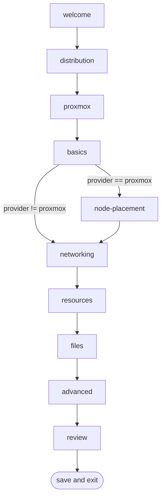

# The wizard

The wizard is the interactive TUI behind `okdctl init`: a hub screen over
an existing `okdctl.yaml`, and the data-driven configure flow underneath
its `edit config` verb (or `get started` on a blank slate). The configure
flow is the only flow it reaches today; the lifecycle screens arrive with
the commands that back them.

## The hub: one program, one live flow

The wizard's entry point is `steps.WelcomeStep`, the hub: a centered
wordmark screen `okdctl init` opens on every time. Over an existing
`okdctl.yaml` it offers `edit config` and `quit`; on a blank slate it
offers `get started` and `quit`. The hub is a hand-written `WizardStep`,
not a `StepDefinition`, since a launcher has no fields to declare. It also
implements `heroRenderer` and `frameWidthOwner`, so the frame drops its
own header chrome and gives it the frame's whole width.

That menu resolves one of two ways. The `edit config` verb, and `get
started` on the blank slate, continue forward into the configure flow in
the same program, along the step list further down this page. `quit`
completes the hub step and leaves the wizard; the CLI reads the
highlighted verb back (`sessionVerb` in `internal/cli/wizard_setup.go`)
once the TUI has released the terminal and logs that nothing changed. The
other `HubVerb` values exist for the lifecycle screens and are not offered
until a command backs them.

## Unsaved edits: nothing persists until review

The configure flow keeps its progress in memory only. That progress is
the `*config.Config` the steps write into: every keystroke in a form
field applies the active step to it (`ConfigSyncMsg`), so a step left
with escape has already written what was typed. A value a field's own
`Check` rejects stays out of that sync, so a half-typed number never
reaches the config. The config file itself is written exactly once, by
`persistWizardConfig` in `internal/cli/init.go`, after the review step's
`save and exit` action is confirmed; a session closed or quit before then
leaves `okdctl.yaml` as it was.

Secrets follow the same rule by a separate route. The proxmox step's
`api token` field and `skip tls verify` toggle never enter the config.
They surface through `StepDefinition.Secrets` as a `wizard.Secrets`
value, and the CLI writes `okdctl.env` from it beside the config, only
when a token was typed or the TLS toggle moved from what the session
opened with.

That is why quitting asks first. The first ctrl+c on a configure step
(distribution through review) whose live state no longer matches the one
the session opened with raises a one-line question in the status row; a
second ctrl+c or `y` discards the edits and quits, and any other key
returns to the form. That comparison is `sessionDigest` in
`discardconfirm.go`: a sha256 over the config's JSON form plus, per
secrets provider, whether a token is present and the TLS toggle. The
token bytes never enter the hash. An edit typed and then typed back is no
edit at all, and ctrl+c with nothing changed quits immediately. This
applies to the configure flow only: the hub quits as before.

## Data-driven, not code-driven

Most steps are declared as a `StepDefinition` value with sections, fields
and validators, and the runtime in `internal/tui/wizard/datadriven.go`
renders any of them without per-step code. The struct carries an `ID`,
the titles and description, `Sections`, and the hooks `Validate`,
`Apply`, `Secrets`, `ShouldShow`, `ExtraContent` and `ExtraContentTitle`.
Read the struct itself rather than a copy here; the field comments on it
are the contract.

A `SectionDefinition` groups fields under a title and note, and can carry
a `Warning` renderer, a `Visible` predicate, a `Collapsible` fold with its
`FoldSummary`, and an `AbsenceNote` for a hidden section.

The wizard package lives under `internal/tui/wizard/`:

- `datadriven.go` is the runtime that renders any `StepDefinition`.
- `steps/` holds the step files: `welcome`, `distribution`, `proxmox`,
  `basics`, `node_placement`, `networking`, `resources`, `files`,
  `advanced` and `review`. Four of them are hand-written `WizardStep`
  types (the hub, the distribution picker, node placement and review);
  the other six are `StepDefinition` literals plus their helper
  validators.

Adding a new step takes three additive edits: create the file under
`steps/`, add a `StepType` constant and a `DefaultConfig()` entry in
`internal/tui/wizard/config.go`, and register a factory in `RegisterAll`
in `steps/register.go`, which `internal/cli/wizard_setup.go` calls.

## FieldDefinition: the smallest unit

A `FieldDefinition` names a config key (the `config.Field*` constants),
its label, default, placeholder, help, type (`FieldTypeText`,
`FieldTypePassword`, masked and scrubbed from error text, or
`FieldTypeSelect` with `Options`), whether it is required, a `Validate`
function and the two-way bridge `ConfigSet` / `ConfigGet` between the
form's `map[string]string` and the typed `*config.Config`; the api token
field has no `ConfigSet` and reaches `okdctl.env` through `Secrets`
instead. The `SetString`, `SetInt`, `SetBool`, `GetString` and
`GetInt` helpers in `datadriven.go` wrap the conversions so definitions
stay terse.

The field validators are the exported `config.Check*` functions, the same
checks `config.Config.Validate` runs, so the wizard and `okdctl config
validate` cannot disagree about a value.

`Width` picks one of four `FieldWidth` classes, sizing the input box in
columns independent of the section's width: `FieldWidthAuto` (the zero
value), `FieldWidthNumber` (16 columns, for counts and byte sizes),
`FieldWidthPath` (`formMaxWidth` less the box border, for filesystem
paths) and `FieldWidthFull` (the whole inner width). `PairKey` lets two
adjacent fields share one row when the form is at least `pairMinWidth`
(70) columns wide; below that every field stacks.

## Why data-driven

The payoff is consistency and testability. Every step gets the same
header, navigation, validation behavior, help text placement and keyboard
shortcuts, because one runtime renders them all; hand-written bubbletea
models would drift apart step by step. The step definitions are pure data
with pure validator functions, so a validator is unit-tested and a step's
rendered output is golden-tested without a TTY (`internal/tui/tuitest`).

## The escape hatch: ExtraContent and WithExtraContentFunc

Some steps need to render content that is not a form field: a derived
address preview, a notes card, a warning banner. These steps use
`ExtraContent` in the definition or `WithExtraContentFunc` on the step
instance to render lipgloss output below the form, titled by
`ExtraContentTitle`.

This is the only point where a data-driven step can have custom
rendering. A step that needs more than `ExtraContent` allows is written
by hand, as node placement is, rather than by adding an escape hatch to
the runtime.

## Layout: the frame budget

The wizard renders inside a fixed frame budget, so every resize keeps the
header, viewport, status row and footer stacked in the same shape, with
no leftover row that could push the border past the last terminal line.

That budget is `fixedLayoutOverhead` in `model.go`: three rows for the
header (the brand row, the title/trail row and the bottom rule), one row
for the status row, two rows for the footer (the scroll-indicator rule
and the help bar), and four rows of vertical padding (the wizard border's
top and bottom plus the outer container's top and bottom). The total is
10, so the viewport height is `V = H - 10` at every terminal height `H`.
The one exception is a hero step: `layoutOverhead` hands the hub the
three header rows it draws itself, so its viewport is `H - 7`.

The same accounting applies horizontally: the content column is `W - 6`
(four columns of outer padding plus the wizard border's two side
columns), and the bordered box lipgloss draws around that content is
`W - 4`. The wizard's floor is 60x20 (`minTerminalWidth`,
`minTerminalHeight`). Below it the wizard draws nothing but a one-line
notice asking for a larger terminal, and `contentWidth` clamps to 54 so
no layout math goes negative while the notice is up.

That frame always spans the terminal, but the body inside it has a
ceiling: a step's content renders in one column capped at 110
(`singleFormMaxWidth`), so a wide terminal does not stretch the form edge
to edge. The leftover columns become blank right-hand margin inside the
frame. The one exemption is a step that owns the frame's width
(`frameWidthOwner`: the hub), which renders across the whole content
width instead.

| Terminal      | Frame width | Content width | Body width | Viewport height |
| ------------- | ----------- | ------------- | ---------- | --------------- |
| 60x20 (floor) | 56          | 54            | 54         | 10              |
| 80x24         | 76          | 74            | 74         | 14              |
| 100x30        | 96          | 94            | 94         | 20              |
| 120x40        | 116         | 114           | 110        | 30              |
| 180x48        | 176         | 174           | 110        | 38              |

The golden tests in `steps/golden_test.go` pin one frame per step at
80x24, the dense steps at 120x40 as well, and assert every frame fits
its terminal at 80x24, 100x30, 120x40, 150x24 and 180x48.

## The status row

The status row is always exactly one row, whether or not it has anything
to show, so a step reporting an error never grows or shrinks the frame
around it. The row renders blank when `m.err` is nil and an error icon
plus message once it is set, inset two spaces to match the viewport's
content column; the discard question above renders in the same row. The
row's style calls `Inline(true)` rather than `Padding`, since lipgloss v2
skips `Padding` under `Inline`, so the inset is prepended literally.

## Validation lifecycle

The wizard runs validation in layers, so a mistake surfaces only once the
user has had a chance to see it:

- The first layer is per field: typing clears that field's error
  immediately, and leaving a field (tab or shift-tab) runs the field's
  `Check` and records the result, but only for a field the user has
  focused. Tabbing past a field the user never visited cannot manufacture
  an error for it.
- The second layer fires on enter: `TouchAll` marks every visible field
  touched, `Validate` records every field's current error across the
  form, and `FocusFirstInvalid` moves focus and the viewport to the first
  invalid one. The status row shows a generic "fix the highlighted
  fields" message while each field's own error row carries the
  specifics.
- The third layer is `StepDefinition.Validate`, which runs only once
  every field passes and enforces cross-field invariants a single field's
  `Check` cannot see.

Two steps then run regardless of which layer caught something: `Apply`
writes the step's values into `*config.Config` once validation passes,
and `config.Config.Validate` runs once more at save time, the same
validator `okdctl config validate` runs. The review step refuses enter
while any of its preflight checks fails, and the CLI refuses to write a
file that fails validation.

That layering is also why a `Default` on a `FieldDefinition` counts as a
real starting value rather than a placeholder: it satisfies a `Required`
field immediately, so the wizard never manufactures an error for a field
the user has not touched. `Placeholder`, by contrast, is a dim hint shown
while the field is empty and never becomes part of the value.

Escape does not discard state. It stays in the step's field values so the
user can come back and tweak.

The step flow is shown below. The one step with a `ShouldShow` predicate
appears twice, once as the active step and once as a bypass, to make the
condition explicit:

The review step also offers digit jumps back to any step from basics to
advanced (`reviewJumpOrder`); escape after a jump returns to review.

## Discovery runs through the driver

The node placement step lists the Proxmox cluster's nodes with the
endpoint, token and TLS toggle the proxmox step collected, through
`internal/proxmox.Driver.Nodes`, the same driver `okdctl doctor` uses.
The wizard owns no Proxmox client of its own. A missing endpoint or token
is reported in the step, and a failed attempt retries on re-entry.

## HA lives on the proxmox step

The proxmox step's `ha` toggle, in its `advanced` section, sets
`provider.proxmox.ha`. In particular, HA needs a multi-node Proxmox
cluster, since a single host cannot relocate anything, and once enabled
ha-manager supersedes the per-VM `startup{}` ordering on any HA-triggered
relocation. The `advanced settings` step holds the cluster networks, the
node lifecycle hook and the install options, not HA.

## Scrolling to the focused field: LineSpan and SpanProvider

The wizard keeps the focused field on screen by asking the active step
where that field lives in its own `View()` output, rather than tracking
scroll position itself. That contract is `SpanProvider`: a step
implementing `FocusedSpan() (LineSpan, bool)` reports the inclusive
0-based line range the focused field occupied the last time the step
rendered, or `false` when nothing is focused yet or the step has not
rendered at all.

This works because `MultiSectionForm` records a span per field during
`View`, so `FocusedSpan` only has to look up the focused group's index.
That span cannot be looked up directly against the viewport, since
`padContent` may have wrapped an over-wide step line into several
viewport rows; `viewportSpan` translates a step-line span into viewport
rows using the `contentRows` index `padContent` recorded, before
`scrollToFocusedField` decides whether to move the viewport's offset at
all. A centered step never implements `SpanProvider`: its content is
re-rendered with a `PaddingTop` shift before it is measured, which would
desynchronize any span recorded before that shift.

In particular, a span taller than the viewport, or one whose start sits
above the visible window, snaps the viewport to the span's start; a span
whose end has scrolled past the bottom snaps that end onto the last
visible row; a span already fully visible leaves the viewport untouched.
This is the mechanism `FocusChangedMsg` triggers on every focus move, and
the one `FocusFirstInvalid` rides after an enter-key validation failure.

## Why not huh, survey, or promptui

The Charmbracelet `huh` library is great for one-shot forms but fights
the multi-section, back-and-forth, live-preview structure this wizard
needs. The data-driven model gives what `huh` would have given
(consistent rendering, reusable validators) plus per-step extra content,
which `huh` does not support.

The wizard is built directly on `bubbletea`, `bubbles` and `lipgloss`.
